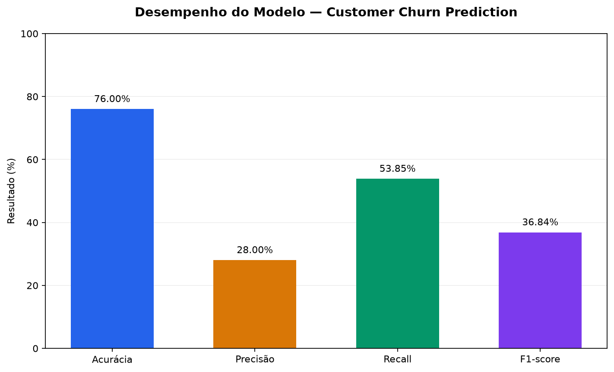
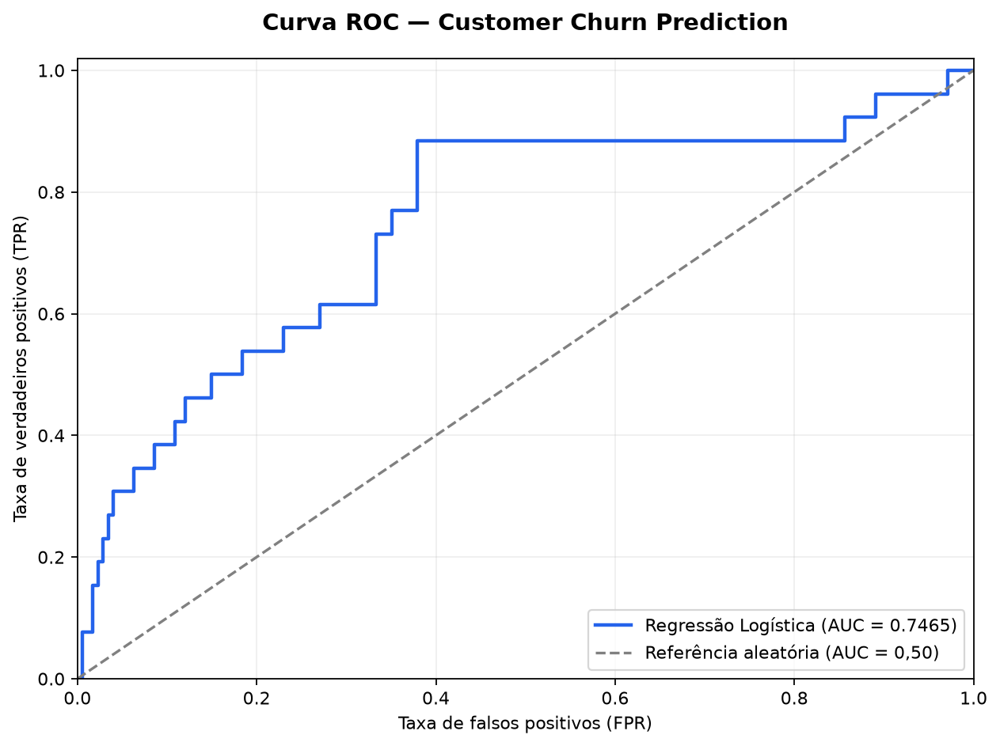
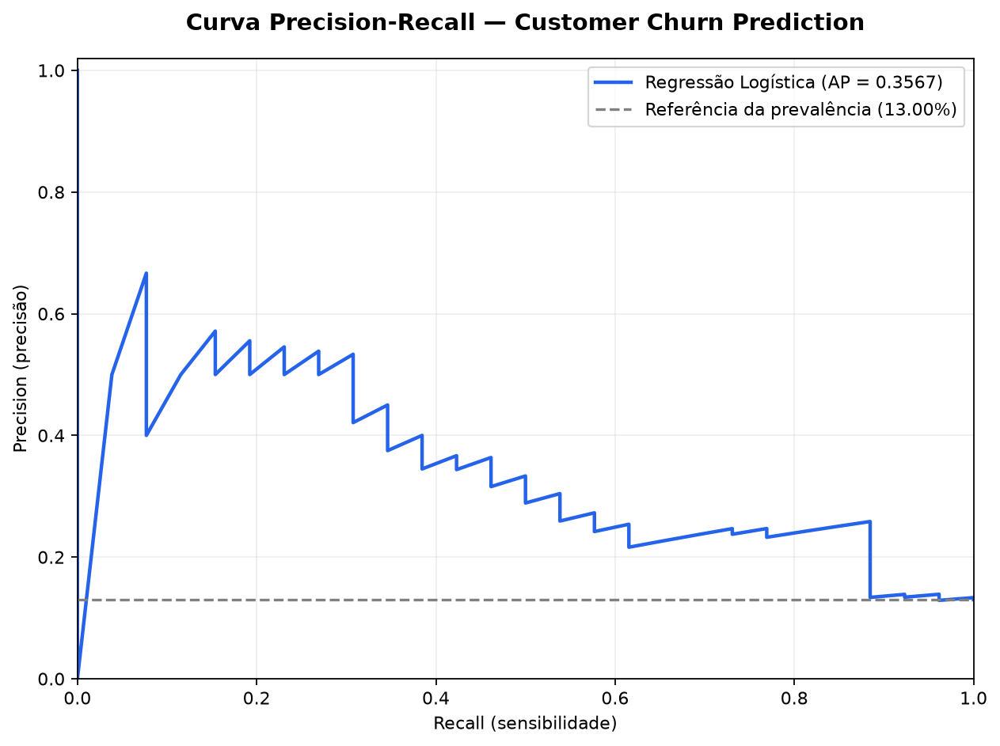
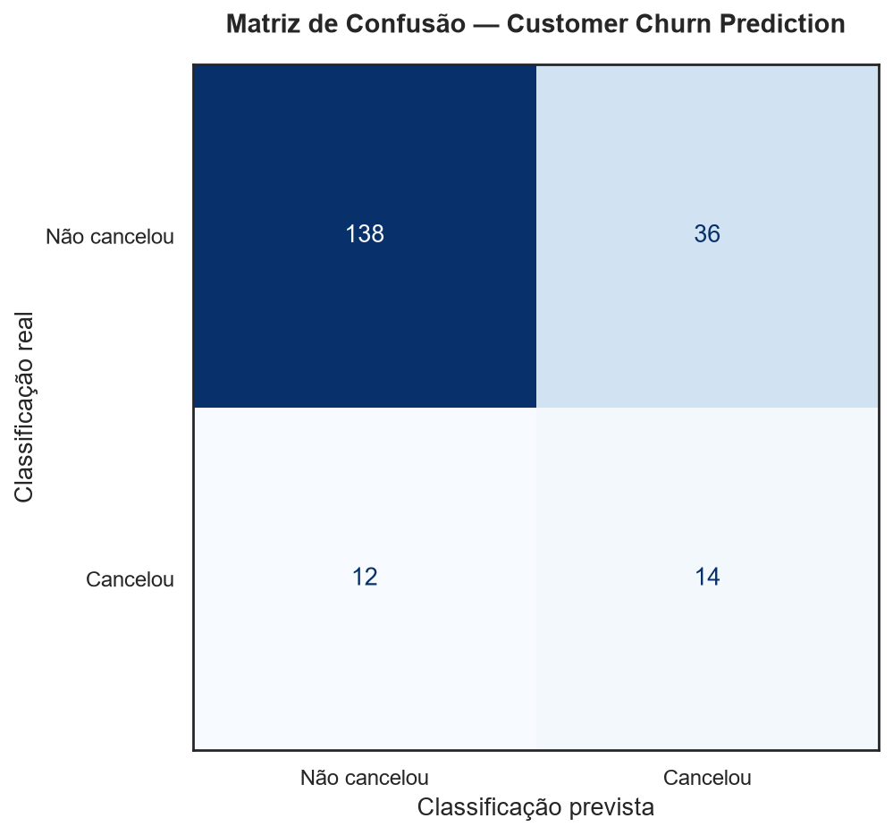

# Relatório Executivo — Customer Churn Prediction

**Projeto:** Conecta Brasil Telecom
**Versão:** 1.1 — Protótipo educacional
**Área:** Ciência de Dados e Machine Learning
**Problema:** Predição de cancelamento de clientes (Customer Churn)

---

## 1. Resumo executivo

O projeto Customer Churn Prediction foi desenvolvido para simular a identificação de clientes com maior probabilidade de cancelar serviços de uma operadora fictícia de telecomunicações.

Foi construído um modelo de classificação utilizando Regressão Logística, com base em informações de atendimento e satisfação dos clientes.

O projeto utiliza exclusivamente dados sintéticos e possui finalidade educacional.

O modelo apresentou acurácia de **76,00%**, recall de **53,85%** e precisão de **28,00%** no conjunto de teste.

Os resultados demonstram a viabilidade técnica do fluxo de predição, mas não comprovam desempenho ou benefícios financeiros em operações reais.

## 2. Problema de negócio

O cancelamento de clientes representa um desafio para empresas que dependem de receitas recorrentes.

A identificação antecipada de clientes com risco de cancelamento pode apoiar estratégias como:

- Atendimento preventivo.
- Priorização da resolução de reclamações.
- Análise de insatisfação dos clientes.
- Desenvolvimento de estratégias de retenção.
- Alocação mais eficiente de recursos comerciais.

O objetivo do modelo é simular uma ferramenta de apoio à identificação desses clientes.

## 3. Dados utilizados

O conjunto de dados contém **1.000 clientes sintéticos**.

| Indicador                 | Quantidade |
| ------------------------- | ---------: |
| Total de clientes         |      1.000 |
| Clientes sem cancelamento |        869 |
| Clientes com cancelamento |        131 |
| Taxa de churn             |     13,10% |

### Variáveis preditoras

- `total_atendimentos`: quantidade total de atendimentos.
- `atendimentos_abertos`: quantidade de atendimentos não resolvidos.
- `media_satisfacao`: satisfação média do cliente, entre 1 e 5.

Os registros são fictícios e não contêm informações pessoais de clientes reais.

## 4. Metodologia

O algoritmo utilizado foi a **Regressão Logística**, implementada com Scikit-learn.

Os dados foram divididos de maneira estratificada:

| Conjunto    | Registros |
| ----------- | --------: |
| Treinamento |       600 |
| Validação |       200 |
| Teste       |       200 |

O limiar de classificação (*threshold*) adotado foi de **0,20**, selecionado a partir da análise do F1-score no conjunto de validação.

O conjunto de teste foi consultado em etapas anteriores do desenvolvimento educacional. Portanto, os resultados não constituem uma avaliação completamente independente de todas as decisões do projeto.

## 5. Resultados do modelo

### Comparação das métricas de classificação

*Figura: comparação das métricas obtidas no conjunto de teste sintético.*

| Métrica          | Resultado |
| ----------------- | --------: |
| Acurácia         |    76,00% |
| Precisão         |    28,00% |
| Recall            |    53,85% |
| F1-score          |    36,84% |
| ROC-AUC           |    0,7465 |
| Average Precision |    0,3567 |

### Curva ROC e capacidade de discriminação

A curva ROC apresenta a relação entre a taxa de verdadeiros
positivos (TPR) e a taxa de falsos positivos (FPR) conforme
o limiar de classificação é alterado.

O modelo de Regressão Logística apresentou ROC-AUC de
0,7465 no conjunto de teste sintético, indicando capacidade
de discriminação superior à referência aleatória (0,50).

*Figura: curva ROC calculada a partir das probabilidades
previstas para os 200 clientes do conjunto de teste sintético.*

### 

### Curva Precision-Recall e desempenho na identificação de churn

A curva Precision-Recall apresenta a relação entre precisão e
sensibilidade (recall) conforme o threshold de classificação varia.

O modelo apresentou Average Precision (AP) de 0,3567 no conjunto
de teste sintético, resultado superior à prevalência de churn
de 13,00%.

Esse resultado indica capacidade de discriminação da classe
positiva, embora exista um compromisso entre identificar mais
cancelamentos e aumentar o número de alertas falsos.

*Figura: curva Precision-Recall calculada a partir das
probabilidades previstas para os 200 clientes do conjunto
de teste sintético.*

Matriz de confusão

| Resultado real | Previsto: não cancelou | Previsto: cancelou |
| -------------- | ----------------------: | -----------------: |
| Não cancelou  |                     138 |                 36 |
| Cancelou       |                      12 |                 14 |

### Visualização da matriz de confusão

*Figura: matriz de confusão obtida no conjunto de teste sintético, utilizando threshold de classificação de 0,20.*

Dos 26 clientes que efetivamente cancelaram no conjunto de teste, **14 foram identificados corretamente**.

O modelo também sinalizou **36 clientes que não cancelaram**, demonstrando a importância de considerar o custo dos falsos positivos.

## 6. Simulação de impacto financeiro

Para ilustrar os possíveis custos operacionais, consideramos uma ação de retenção hipotética de **R$ 100 por cliente sinalizado**.

| Indicador                                         |    Valor |
| ------------------------------------------------- | -------: |
| Clientes sinalizados                              |       50 |
| Custo por ação                                  |   R$ 100 |
| Custo total das ações                           | R$ 5.000 |
| Falsos positivos                                  |       36 |
| Custo das ações direcionadas a falsos positivos | R$ 3.600 |

Esses valores são exclusivamente ilustrativos.

O custo de uma ação destinada a um falso positivo não representa necessariamente desperdício integral, pois a iniciativa pode gerar outros benefícios. A efetividade e o retorno financeiro precisariam ser medidos em experimentos controlados.

## 7. Limitações

O projeto apresenta as seguintes limitações:

- Os dados são sintéticos.
- O modelo não foi validado com clientes reais.
- A precisão de 28% indica quantidade relevante de falsos positivos.
- O recall de 53,85% demonstra que parte dos cancelamentos não foi identificada.
- Não foram realizados estudos completos de viés ou estabilidade temporal.
- As probabilidades não foram avaliadas quanto à calibração.
- Não existe comprovação de redução de churn ou retorno financeiro.
- O conjunto de teste foi consultado durante o processo educacional de desenvolvimento.

O modelo não deve ser utilizado para decisões comerciais reais sem validações adicionais.

## 8. Arquitetura e disponibilização

O projeto contempla:

- Python e Scikit-learn para Machine Learning.
- FastAPI para disponibilização das previsões.
- Docker para conteinerização.
- Pytest para testes automatizados.
- Ruff para análise estática.
- GitHub Actions para integração contínua.
- Render para hospedagem demonstrativa da API.

**API pública:** https://conecta-brasil-churn-api.onrender.com

**Documentação interativa:** https://conecta-brasil-churn-api.onrender.com/docs

A disponibilidade da instância gratuita pode variar, incluindo períodos de suspensão por inatividade.

## 9. Recomendações

Para uma eventual evolução do projeto, recomenda-se:

1. Obter dados reais autorizados e representativos.
2. Realizar uma avaliação independente em dados não utilizados no desenvolvimento.
3. Investigar novos atributos e algoritmos.
4. Avaliar a calibração das probabilidades.
5. Estimar os custos de falsos positivos e falsos negativos.
6. Realizar experimentos para medir a efetividade das ações de retenção.
7. Implementar monitoramento e controles de segurança antes de qualquer uso operacional.

## 10. Conclusão

O projeto demonstra um fluxo completo de desenvolvimento de uma solução educacional de Machine Learning, incluindo preparação de dados, treinamento, avaliação, disponibilização por API e testes automatizados.

Embora o modelo apresente limitações importantes, o trabalho constitui uma demonstração prática de competências em Ciência de Dados, desenvolvimento Python, integração contínua e implantação de aplicações.

**Conclusão executiva:** a solução está apta para demonstração técnica e portfólio, mas não para decisões comerciais reais.
